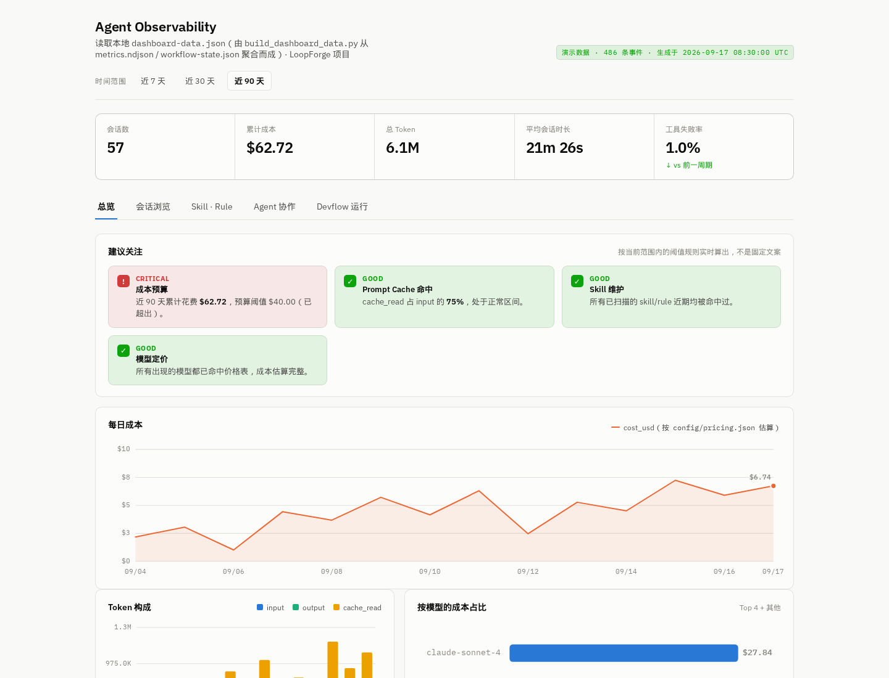

# LoopForge Local 使用指南

[English](../../docs/local/usage.md) | 简体中文

> **旧版（Legacy）。** LoopForge Local 在编码助手中运行内置的 Classic 和 Portable 工作流，无需 LoopForge 服务端。已有项目可以继续使用已发布的版本。

## 通过 MCP 连接 LoopForge

使用运行中的 LoopForge 实例，通过 CodeBuddy 访问该实例上的项目、SOP 和运行记录。需要实例时，参阅[部署指南](../deployment.md)。

1. 登录 LoopForge，打开 **接入方式**（Access），创建个人访问令牌，并选择 **CodeBuddy** 获取其 MCP 接入指引。
2. 在 CodeBuddy 中应用用户级配置，在 MCP 设置中确认 `agentflow` 服务已连接。让 CodeBuddy 列出你的 LoopForge 项目，以验证接入是否正常。

端点与可用操作见 [MCP API 参考](../api/README.md#公共能力发现与-mcp)。

## 快速开始

需要 Node.js 20+ 和 Python 3.8+。把下文命令中的 `X.Y.Z` 替换成你为所用 Agent 和 Edition 选择的已发布版本。可用 `npm view loopforge-cli versions --json` 列出已发布版本。宿主支持情况取决于你安装的版本。

| Agent | 安装 | 启动工作流 |
| --- | --- | --- |
| CodeBuddy | `npx -y loopforge-cli@X.Y.Z install codebuddy` | `/start-devflow "<request>"` |
| Codex | `npx -y loopforge-cli@X.Y.Z install codex` | `$devflow-codex "<request>"` |
| Cursor | `npx -y loopforge-cli@X.Y.Z install cursor` | `/start-devflow "<request>"` |
| Claude Code | `npx -y loopforge-cli@X.Y.Z install claude` | `/start-devflow "<request>"` |
| DeepSeek Harness | `npx -y loopforge-cli@X.Y.Z skills install dsh` | `/devflow "<request>"` |
| Hermes Agent | `npx -y loopforge-cli@X.Y.Z skills install hermes`，然后 `hermes skills trust .` | `/devflow "<request>"` |

以 Claude Code 为例：

```bash
npx -y loopforge-cli@X.Y.Z install claude
npx -y loopforge-cli@X.Y.Z status claude
```

```text
/start-devflow "add status filtering to the order list and cover the API with tests"
```

任何安装都可以用 `npx -y loopforge-cli@X.Y.Z status <agent>` 检查。如果安装或执行失败，先诊断环境：

```bash
npx -y loopforge-cli@X.Y.Z doctor
```

Pi、DeepSeek Harness 和 Hermes Agent 通过 [Portable Edition](#portable-edition) 支持。DSH 有一个[可选插件](../../local/dsh-plugin/README.md)，提供任务控制、状态、制品和审批门禁。Hermes 使用项目级的 Agent Skills 发现机制和 `delegate_task` 工具，不会修改 `~/.hermes/config.yaml`。Hermes 用户还可以选择安装原生 [Hermes 插件](../../local/hermes-plugin/README.md)，获得同样的 `/loopforge status`、`/loopforge result` 和 `/loopforge approve` 控制。

## 工作方式

1. **先理解问题**：Agent 先调研项目，澄清目标、范围和验收标准，而不是立刻开始写代码。
2. **确认边界后再实施**：中大型任务会在你确认目标、范围、排除项、关键决策和验收标准之后，才进入设计与实现。
3. **职责分离**：设计、实现、审查和测试由职责独立的角色分阶段完成，减少单一上下文中的自审偏差。
4. **展示证据，而不只是 diff**：需求、方案、变更、审查意见和测试结果都会保存下来，便于检查、交接和复盘。
5. **中断后继续**：工作流状态会被持久化，下一次会话可以从未完成的阶段继续，而不必从头开始。

LoopForge 按任务复杂度选择路径：小改动走精简的单角色路径，完整的角色分工工作流只留给能从中受益的中大型任务。

```text
Your request
   │
   ├─ Small change ───────> Understand → implement → verify → deliver
   │
   └─ Medium/large task ──> Clarify and confirm → design → implement
                                                   → independent review → test → deliver
                              │
                              └── State and artifacts are saved throughout
```

## 支持的 Agent

| Agent | Classic Edition（默认） | Portable Edition |
| --- | --- | --- |
| CodeBuddy | ✓ | ✓ |
| Codex | ✓ | ✓ |
| Cursor | ✓ | ✓ |
| Claude Code | ✓ | ✓ |
| Pi | — | ✓ |
| DeepSeek Harness | — | ✓ |
| Hermes Agent | — | ✓ |

在同一项目中，LoopForge 对每个编码 Agent 只启用一种 Edition。两者的区别与目录布局见 [Edition 选择](editions.md)。

## 你会得到什么

一次任务结束时，你会得到代码变更，以及已确认的需求、技术方案、独立审查意见、测试结果和交付总结。LoopForge 默认把这些历史保存在 `artifacts/{task_slug}/` 下，便于检查、交接和复盘。

<details>
<summary>查看默认制品目录</summary>

不同 Edition 之间，部分目录名称会有差异。

```text
01-requirement/   Confirmed goals, scope, and acceptance criteria
02-design/        Technical design and execution plan
03-code/          Code changes and independent review report
04-e2e/           Test results
05-knowledge/     Reusable project knowledge
workflow-summary.md
```

</details>

Classic 工作流中断后，可在 CodeBuddy、Cursor 或 Claude Code 上用 `/resume-devflow {task_slug}` 恢复，在 Codex 上使用 `$devflow-codex resume {task_slug}`。每个已安装的宿主包都会说明其状态查看、终止和单阶段命令。

## 看见 Agent 如何工作

CodeBuddy 的 Classic Edition 内置本地可观测看板。它把工作流证据转成一张视图，集中呈现会话活动、Token 与成本趋势、Skill/Rule 使用情况、角色派发以及 Devflow 阶段归因，便于定位高成本运行、确认自动化是否真的在被使用，并复盘工作如何在角色之间流转。



_看板示例使用合成演示数据。_

看板在本地生成并提供服务，不依赖外部遥测服务。运行日志可能包含工具参数和输出片段，因此 LoopForge 默认将它们排除在 Git 之外，未经检查不应对外分享。

<details>
<summary>打开本地看板</summary>

在项目根目录至少运行一次 CodeBuddy 会话后：

```bash
python3 .codebuddy/skills/agent-observability/scripts/build_dashboard_data.py --project-root .
python3 -m http.server 8765 --directory .codebuddy/skills/agent-observability/scripts/dashboard
```

在浏览器打开 `http://localhost:8765`。数据源、自定义定价和故障排查见[可观测性快速上手](../../local/.codebuddy/skills/agent-observability/references/quickstart.md)。

</details>

## 什么时候适合使用

LoopForge 尤其适合以下场景：

- 需求仍然模糊，需要先澄清目标或边界；
- 改动跨多个模块，应该先设计方案再实施；
- 实现、审查和测试应当由不同角色完成；
- 工作可能跨越多个会话，需要可恢复的状态；
- 团队希望留下可检查的交付记录，用于交接或复盘。

如果只是一次性的代码补全，或非常明确的微小修改，直接用编码 Agent 通常就够了。进入 LoopForge 的简单任务会走它的精简路径。

## Portable Edition

需要基于 Agent Skills 的可移植工作流时，使用 Portable Edition。为避免同一个编码 Agent 加载两套工作流、混淆状态或制品，LoopForge 在每个项目中只对同一编码 Agent 启用一种 Edition。要切换 Edition，用 `--force` 执行新的安装命令。

| Agent | 安装 | 启动工作流 |
| --- | --- | --- |
| CodeBuddy | `npx -y loopforge-cli@X.Y.Z skills install codebuddy` | `/devflow "<request>"` |
| Codex | `npx -y loopforge-cli@X.Y.Z skills install codex` | `$devflow "<request>"` |
| Cursor | `npx -y loopforge-cli@X.Y.Z skills install cursor` | `/devflow "<request>"` |
| Claude Code | `npx -y loopforge-cli@X.Y.Z skills install claude` | `/devflow "<request>"` |
| Pi | `npx -y loopforge-cli@X.Y.Z skills install pi`，然后 `pi install npm:pi-subagents` | `/skill:devflow "<request>"` |
| DeepSeek Harness | `npx -y loopforge-cli@X.Y.Z skills install dsh` | `/devflow "<request>"` |
| Hermes Agent | `npx -y loopforge-cli@X.Y.Z skills install hermes`，然后 `hermes skills trust .` | `/devflow "<request>"`（可选插件：`/loopforge`） |

完整的边界与目录布局见 [Edition 选择](editions.md)。

## 更新与卸载

切换到平台 MCP 或卸载 Local 之前，先备份项目中的 `artifacts/`、`.devflow/`，以及自定义的 Skill 和 Agent 配置，留作 Local 运行记录。仍在进行中的运行请用同一个 Local 版本完成或恢复。

要管理已有的 Local 安装，可以全局安装同一 CLI 版本。

```bash
npm install --global loopforge-cli@X.Y.Z
```

然后用上面相同的 Agent 名称维护安装（`codebuddy`、`codex`、`cursor`、`claude`、`pi`、`dsh` 和 `hermes` 对应 Portable Edition）：

```bash
# Classic Edition
loopforge update <agent>
loopforge status <agent>
loopforge uninstall <agent>

# Portable Edition
loopforge skills update <agent>
loopforge skills status <agent>
loopforge skills uninstall <agent>
```

安装状态保存在 `.devflow/install-state.json`。检测到用户修改或文件冲突时，更新会停止而不是覆盖。只有确实要替换冲突或切换 Edition 时才使用 `--force`，最好先检查 `loopforge plan`。

要从已发布版本的源码安装，先检出对应的 tag，再在仓库根目录执行以下命令。

```bash
pipx install ./local
```

## 可选工具

`tools/tcmcp` 是腾讯云只读 MCP Initializr（Redis、CDB、TDSQL-C、TKE、CLS、COS）。它不属于 `loopforge install`，也不在 npm CLI 包中。从克隆的仓库进入：

```bash
cd local/tools/tcmcp
```

然后按 [`tools/tcmcp/README.md`](../../local/tools/tcmcp/README.md) 操作。云 API 密钥不会写入生成的 zip 或容器镜像，只保留在列出资源或安装 MCP 客户端的机器上。LoopForge Local 的 `local-vX.Y.Z` 发版会发布 `ghcr.io/tencent/loopforge-tcmcp:<version>`。

## 权限与安全

部分宿主的 Classic 配置会启用自动执行或高权限 Agent 模式。请只在可信项目中使用 LoopForge。安装前可用 `loopforge plan codebuddy`、`loopforge plan codex`、`loopforge plan cursor` 或 `loopforge plan claude` 检查计划写入的文件。不要把凭据、私有端点或生产运维配置放进工作流模板。

安全问题请参阅[安全政策](../../SECURITY.md)，并通过 GitHub Security Advisories 私密报告漏洞。
