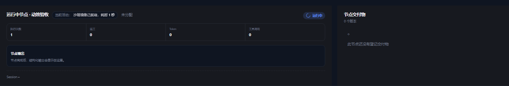

# 节点活动界面验收

本证据使用由该动画贡献构建的真实平台、一次专用的本地测试安装、
一个密码会话和一个合成的 shell SOP。其中不涉及任何模型服务、
生产运行或组织数据。

## 资源缓存升级

`web/index.html` 中的字面查询串并不是发送给浏览器的 URL。
`studioFileServer` 会在每个 HTML 请求上调用 `stampStudioIndex`。每个 CSS 与
JavaScript 引用都会用该资源 SHA-256 哈希的前八个字节重写。HTML 以
`Cache-Control: no-cache` 提供；由此产生的带版本资源使用
`public, max-age=31536000, immutable`。

Chromium 检查保持同一浏览器上下文并启用其 HTTP 缓存：

1. 一个同源 HTTP 代理提供先前的样式表及其内容哈希
   URL，同时把认证、运行 API、流式响应及其他资源转发给
   真实平台。基线是本次贡献之前的样式表。
2. 第二次普通文档导航复用了那个旧样式表。Chromium 的
   DevTools Protocol 报告缓存命中；在两次导航中，代理只收到一次
   针对旧资源的请求。
3. 随后代理原样转发平台当前的 HTML。一次普通
   导航会拉取新的样式表 URL，而已缓存的旧样式表
   并没有阻止任何一个动画出现。整个过程未使用清除缓存、强制刷新、
   Playwright 请求路由或模拟的运行响应。

| 资源 | 提供的 URL | 网络请求 |
| --- | --- | --- |
| 先前 CSS | `/observability.css?v=b5623289d4bd5745` | 1 次，随后从缓存复用 |
| 动画 CSS | `/observability.css?v=e10036f176cdcba1` | 升级后 1 次 |

样式表哈希跟随其字节内容，后续修改会使其改变。手写的
`v=20261031metrics2` 在整个检查过程中保持不变。`internal/httpapi/studio_test.go`
中的回归测试还验证了：仅修改 CSS 就会改变提供的 URL，而无需编辑 HTML
或重建 handler。

## 真实服务的视觉检查

所选节点来自一个真实运行的 shell SOP。计算样式与定时
采样确认了两种主题下的 spinner 旋转和文字高亮移动。
在减少动效偏好下，两个动画都会被禁用。此外还在
390px 视口下检查了检查器；请求取消后，动画经真实的运行更新路径
停止。

以下截图是该实时检查器的最新抓取。它们经过裁剪，
以排除无关的安装控制项，是动画状态的
静态图像。

浅色主题：

深色主题：

校验于 2026-11-11 完成：十项节点检查器测试、样式表
哈希/升级与缓存头的 Go 测试、JavaScript 语法检查，以及上文所述的
实时 Chromium 检查均已通过。这些检查不代表维护者给予
批准，也不代表执行了完整的已部署验收套件。
